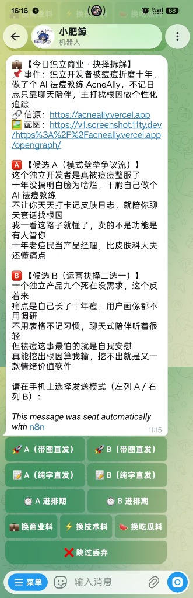
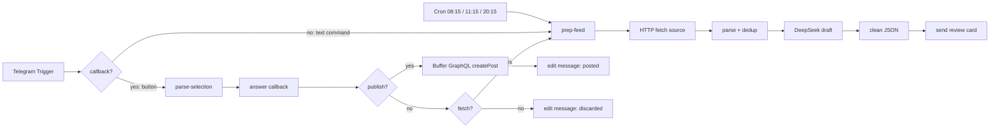

# n8n Hot-Topic Auto Poster

[简体中文](./README.md) | **English**

> DeepSeek writes · You approve in Telegram · Buffer publishes to X / Threads / LinkedIn / Bluesky and more

An n8n workflow that pulls trending topics on a schedule, has DeepSeek draft two versions of a short post, and sends both to your Telegram. **You pick one with a tap**, and the workflow publishes it through [Buffer](https://buffer.com/).

Publishing goes through the Buffer API, so **any platform Buffer supports will work**, not just X. Switching platforms takes one channel ID. See [Multi-platform publishing](#multi-platform-publishing).

> [!WARNING]
> This project is **for learning purposes only**. Follow each platform's rules and your local laws. You are responsible for everything you publish. See the [Disclaimer](#disclaimer).

  
   
  The Telegram review card: one story, two drafts, one tap to publish

> [!NOTE]
> The bundled prompt writes **Simplified Chinese** posts for a Chinese-speaking X audience. To post in English or another language, rewrite the System Message in the `chain-llm` node. The rest of the workflow doesn't depend on the language.

## Features

- **Three rotating sources** (each scheduled run moves to the next one)
  - 💼 Indie business: Hacker News `Show HN` (Algolia API)
  - ⚡ Tech: Hacker News front page (Algolia API)
  - 🍉 Trends: Google Trends US daily RSS
- **Two AI drafts per story**: A and B use different angles. The prompt is tuned to avoid generic "AI voice" and to read well on a phone screen
- **Telegram review card** with one button per action
  - 🚀 Post now with image / 📝 Post now, text only / ⏱️ Add to Buffer queue
  - Fetch another business / tech / trends story, or skip
- **Multi-platform**: publish via Buffer to X, Threads, LinkedIn, Bluesky, Mastodon, Facebook and more, including to several at once
- **Automatic images**: GitHub repos get their OpenGraph card. Other links get a 1200×630 screenshot from the 11ty screenshot service
- **Dedup**: posted links and titles are stored in workflow static data (keeps up to 300)
- **Single-user lock**: only responds to your own Telegram chat ID
- **Manual commands**: send `/biz`, `/tech` or `/trends` to the bot. Any other text fetches the next category in the rotation

## How it works

## Prerequisites

| Requirement | Purpose | Where to get it |
|---|---|---|
| n8n (self-hosted, public HTTPS) | Runs the workflow. The Telegram Trigger needs a reachable webhook | [docs.n8n.io](https://docs.n8n.io/hosting/) |
| Telegram bot token | Sends review cards and receives button taps | [@BotFather](https://t.me/BotFather) |
| Your Telegram chat ID | Allowlist and message recipient | Message [@userinfobot](https://t.me/userinfobot) |
| DeepSeek API key | Writes the drafts | [platform.deepseek.com](https://platform.deepseek.com/) |
| Buffer API token + channel ID | Publishes or queues posts to the social accounts connected in Buffer | Buffer developer settings. Get channel IDs with the Buffer API `channels` query |

## Setup

1. In n8n, go to **Workflows → Import from File** and select [`workflow.json`](./workflow.json).
2. Set up credentials (n8n flags the nodes that are missing them):
   - **Telegram account**: your bot token. Shared by `tg-trigger`, `tg-send-card`, `tg-answer-cb`, `tg-confirm` and `tg-discard-confirm`
   - **DeepSeek account**: your API key (`ds-model`)
   - **Header Auth account**: Name `Authorization`, Value `Bearer <your Buffer token>` (`buffer-post`)
3. Replace the placeholders:
   - `YOUR_TELEGRAM_CHAT_ID` (3 places): the Chat ID field in `tg-send-card`, plus the allowlist checks in the `parse-selection` and `prep-feed` Code nodes
   - `YOUR_BUFFER_CHANNEL_ID` (1 place): the JSON body of `buffer-post`
4. Save and **Activate**. To test, send `/tech` to your bot.

## Multi-platform publishing

The `buffer-post` node calls Buffer's `createPost`. The target platform depends only on `channelId`:

- **Switch platforms**: replace `YOUR_BUFFER_CHANNEL_ID` with the channel ID of the target platform in Buffer.
- **Cross-post**: duplicate `buffer-post` and connect each copy to the true branch of `if-action`, with one channel ID per copy.
- **Adjust the voice**: the prompt targets short X posts (70–120 Chinese characters, short lines, no links in the body). For long-form platforms like LinkedIn, raise the length limit and adjust the tone.

| Platform type | Examples | Notes |
|---|---|---|
| Text with optional image | X, Threads, Bluesky, Mastodon, LinkedIn, Facebook | Works by swapping the channel ID |
| Image or video required | Instagram, Pinterest, TikTok, YouTube | Every post needs media, and some platforms need extra fields in the Buffer API (e.g. a Pinterest board), so you'll have to edit the JSON body |

> Only X has been tested by the author. Reports for other platforms are welcome as issues or PRs.

## Customization

- **Schedule**: edit the `cron-trigger` expression (default `15 8,11,20 * * *`, in your n8n instance's timezone)
- **Sources**: edit the `feeds` object in `prep-feed`. `code-slice` parses Algolia HN JSON, Google Trends RSS and generic RSS/XML
- **Voice / persona / language**: edit the System Message in `chain-llm`
- **Model**: replace `ds-model` with any chat model node n8n supports (OpenAI, Gemini, etc.)

## Notes

- Make sure your posts follow each platform's automation rules (e.g. the [X automation rules](https://help.x.com/en/rules-and-policies/x-automation)) and respect the copyright of the source material. The human-approval step is there to avoid unattended bulk posting.
- `v1.screenshot.11ty.dev` and `opengraph.githubassets.com` are free third-party services and may be rate-limited or go offline.
- Dedup data lives in workflow static data, which is only saved during **production executions of an active workflow**. Manual test runs don't save it.

## Disclaimer

1. **For learning only**: this project is for learning and research on n8n workflow orchestration, LLM integration and social media APIs. **Do not use it for anything illegal or abusive.**
2. **You own your content**: AI-generated text may contain factual errors, bias or infringing material, so review it before you publish. You alone are responsible for anything you generate or publish with this project, and for any resulting account suspension, legal dispute or other loss. The author accepts no liability.
3. **Follow platform rules**: comply with the terms of service, developer policies and automation rules of X, Buffer, Telegram, DeepSeek and any other third-party service, as well as your local laws. Using it for account farming, engagement manipulation, spam, disinformation, or copyright or privacy violations is **prohibited**.
4. **Respect original creators**: source material belongs to its original authors and platforms. Credit your sources and stay within fair use when you paraphrase or remix.
5. **No warranty**: the project is provided "as is", with no guarantee that it works, stays stable or suits any purpose. Changes to third-party APIs may break it at any time. See the [MIT License](./LICENSE) for the full terms.
6. **Acceptance**: by downloading, using or modifying this project, you confirm that you have read and agree to this disclaimer. If you don't agree, stop using it and delete it.

## License

[MIT](./LICENSE)
