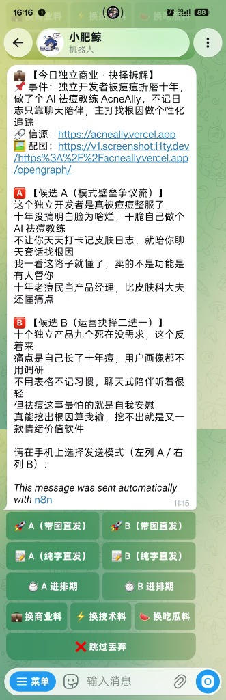
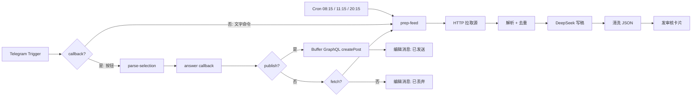

# n8n 热点洗稿与半自动发布工作流

**简体中文** | [English](./README.en.md)

> DeepSeek 写稿 · Telegram 人工审核 · 通过 Buffer 发布到 X / Threads / LinkedIn / Bluesky 等平台

一个 n8n 工作流：定时抓取海外热点 → 用 DeepSeek 写出两版简中短帖 → 推送到你的 Telegram，**由你点按钮决定**怎么发、发哪版 → 通过 [Buffer](https://buffer.com/) 发出去。

发布这一步走的是 Buffer API，所以**Buffer 支持的平台都能接**，不只限于 X。换平台只要换一个频道 ID，详见[多平台发布](#多平台发布)。

> [!WARNING]
> 本项目**仅供学习交流使用**。请遵守各平台规则和当地法律法规，发布内容的责任由使用者自己承担。详见[免责声明](#免责声明)。

  
   
  Telegram 审核卡片：一条素材、两版候选，点一下就发

## 功能

- **三个内容源轮流抓**（每次定时触发换下一个）
  - 💼 独立商业：Hacker News `Show HN`（Algolia API）
  - ⚡ 硬核技术：Hacker News 首页（Algolia API）
  - 🍉 谷歌趋势：Google Trends 美国热搜 RSS
- **AI 双候选**：每条素材生成 A / B 两种风格，系统提示词专门压掉“AI 腔”，排版按手机端短行来写
- **Telegram 审核卡片**：每个按钮对应一种操作
  - 🚀 带图直发 / 📝 纯文字直发 / ⏱️ 加入 Buffer 排期
  - 换商业料 / 换技术料 / 换吃瓜料 / 跳过
- **多平台发布**：经 Buffer 发到 X、Threads、LinkedIn、Bluesky、Mastodon、Facebook 等平台，支持一稿多发
- **自动配图**：GitHub 链接用 OpenGraph 卡片，其他链接用 11ty 截图服务生成 1200×630 预览图
- **去重**：用 workflow static data 记录发过的链接和标题（最多保留 300 条）
- **只认你一个人**：只响应你自己的 Telegram Chat ID
- **手动命令**：在 Bot 对话框发 `/biz`、`/tech`、`/trends`，或任意文字（按轮换顺序取下一个分类）

## 流程

## 准备工作

| 依赖 | 用途 | 获取方式 |
|---|---|---|
| n8n（自托管，需要公网 HTTPS） | 运行工作流；Telegram Trigger 要靠 Webhook 接收消息 | [docs.n8n.io](https://docs.n8n.io/hosting/) |
| Telegram Bot Token | 推送审核卡片、接收按钮点击 | [@BotFather](https://t.me/BotFather) |
| 你的 Telegram Chat ID | 白名单 + 消息接收方 | 给 [@userinfobot](https://t.me/userinfobot) 发条消息就能看到 |
| DeepSeek API Key | 写稿 | [platform.deepseek.com](https://platform.deepseek.com/) |
| Buffer API Token + 频道 ID | 发布 / 排期到你在 Buffer 里连接的社媒账号 | Buffer 开发者设置；频道 ID 可通过 Buffer API 的 `channels` 查询拿到 |

## 安装

1. n8n → **Workflows → Import from File**，选择 [`workflow.json`](./workflow.json)。
2. 配置凭据（导入后节点会提示缺少凭据）：
   - **Telegram account**：填入 Bot Token（`tg-trigger`、`tg-send-card`、`tg-answer-cb`、`tg-confirm`、`tg-discard-confirm` 共用）
   - **DeepSeek account**：填入 API Key（`ds-model`）
   - **Header Auth account**：Name 填 `Authorization`，Value 填 `Bearer <你的 Buffer Token>`（`buffer-post`）
3. 替换占位符：
   - `YOUR_TELEGRAM_CHAT_ID` 出现在 3 处：`tg-send-card` 节点的 Chat ID 字段，`parse-selection` 和 `prep-feed` 两个 Code 节点里的白名单判断
   - `YOUR_BUFFER_CHANNEL_ID` 出现在 1 处：`buffer-post` 节点的 JSON Body
4. 保存并 **Activate**。可以先给 Bot 发 `/tech` 试跑一次。

## 多平台发布

`buffer-post` 节点调用的是 Buffer 的 `createPost`，发到哪个平台只看 `channelId`：

- **换平台**：把 `YOUR_BUFFER_CHANNEL_ID` 换成目标平台在 Buffer 里的频道 ID。
- **一稿多发**：复制几个 `buffer-post` 节点并联到 `if-action` 的 true 分支，每个填一个频道 ID。
- **调整文风**：系统提示词是按 X 简中短帖（70~120 字、短行排版、正文不放链接）写的。发 LinkedIn 这类长文平台时，可以放宽字数，改改语气。

| 平台类型 | 例子 | 说明 |
|---|---|---|
| 文字 + 可选配图 | X、Threads、Bluesky、Mastodon、LinkedIn、Facebook | 换频道 ID 就能用 |
| 必须带图或视频 | Instagram、Pinterest、TikTok、YouTube | 需要始终带媒体，有的平台还要在 Buffer API 里填额外字段（比如 Pinterest 的 Board），要自己改 JSON Body |

> 作者只在 X 上实测过。其他平台欢迎提 Issue / PR 反馈。

## 自定义

- **发送时间**：改 `cron-trigger` 的表达式（默认 `15 8,11,20 * * *`，按 n8n 实例的时区）
- **内容源**：改 `prep-feed` 里的 `feeds` 对象。`code-slice` 能解析 Algolia HN JSON、Google Trends RSS 和普通 RSS/XML
- **文风 / 人设**：改 `chain-llm` 的 System Message
- **模型**：`ds-model` 可以换成 n8n 支持的其他 Chat Model 节点（OpenAI、Gemini 等）

## 注意事项

- 发内容前请确认符合各平台的自动化规则（比如 X 的[自动化规则](https://help.x.com/en/rules-and-policies/x-automation)）和原素材的版权要求。本工作流保留人工审核环节，就是为了避免无人值守地批量发帖。
- `v1.screenshot.11ty.dev` 和 `opengraph.githubassets.com` 都是第三方免费服务，可能限流或失效。
- 去重数据存在 workflow static data 里，只在**已激活的生产执行**中持久化，手动测试运行时不会保存。

## 免责声明

1. **仅供学习交流**：本项目只用于学习和研究 n8n 工作流编排、大模型调用和社交平台 API 集成，**请勿用于任何违法违规用途**。
2. **内容责任自负**：AI 写的内容可能有事实错误、偏见或侵权风险，发布前请自己核实。用本项目生成、发布的任何内容，以及由此引起的账号处罚、法律纠纷或其他损失，都由使用者自己承担，与作者无关。
3. **遵守平台规则**：请遵守 X、Buffer、Telegram、DeepSeek 等第三方服务的用户协议、开发者政策和自动化规则，以及当地法律法规。**禁止**用来批量养号、刷量、发垃圾信息、散布虚假信息，或侵犯他人的版权和隐私。
4. **尊重原作者**：热点素材的版权归原作者和原平台所有。转述、二次创作时请注明出处，遵守合理使用的原则。
5. **不提供担保**：本项目按“现状”提供，不保证可用、稳定或适合某个用途；第三方服务的接口变化可能随时导致它失效。具体条款见 [MIT License](./LICENSE)。
6. **使用即视为同意**：下载、使用或修改本项目，即表示你已阅读并同意本声明。如果不同意，请立即停止使用并删除相关文件。

## License

[MIT](./LICENSE)
