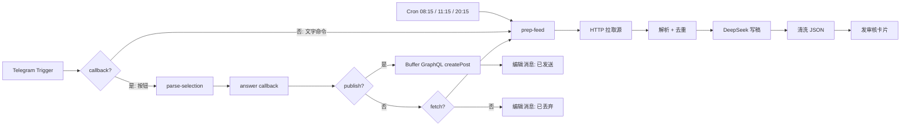

# n8n X 热点洗稿与半自动发布工作流

> DeepSeek 写稿 · Telegram 人工审核 · Buffer 发布到 X（Twitter）

一个 n8n 工作流：定时抓取海外热点 → 用 DeepSeek 写出两版简中推文 → 推送到你的 Telegram，**由你点按钮决定**怎么发、发哪版 → 通过 Buffer 发到 X。

  
   
  Telegram 审核卡片：一条素材、两版候选，点一下就发

## 功能

- **三个内容源轮流抓**（每次定时触发换下一个）
  - 💼 独立商业：Hacker News `Show HN`（Algolia API）
  - ⚡ 硬核技术：Hacker News 首页（Algolia API）
  - 🍉 谷歌趋势：Google Trends 美国热搜 RSS
- **AI 双候选**：每条素材生成 A / B 两种风格，系统提示词专门压掉“AI 腔”，排版按手机端短行来写
- **Telegram 审核卡片**：每个按钮对应一种操作
  - 🚀 带图直发 / 📝 纯文字直发 / ⏱️ 加入 Buffer 排期
  - 换商业料 / 换技术料 / 换吃瓜料 / 跳过
- **自动配图**：GitHub 链接用 OpenGraph 卡片，其他链接用 11ty 截图服务生成 1200×630 预览图
- **去重**：用 workflow static data 记录发过的链接和标题（最多保留 300 条）
- **只认你一个人**：只响应你自己的 Telegram Chat ID
- **手动命令**：在 Bot 对话框发 `/biz`、`/tech`、`/trends`，或任意文字（按轮换顺序取下一个分类）

## 流程

## 准备工作

| 依赖 | 用途 | 获取方式 |
|---|---|---|
| n8n（自托管，需要公网 HTTPS） | 运行工作流；Telegram Trigger 要靠 Webhook 接收消息 | [docs.n8n.io](https://docs.n8n.io/hosting/) |
| Telegram Bot Token | 推送审核卡片、接收按钮点击 | [@BotFather](https://t.me/BotFather) |
| 你的 Telegram Chat ID | 白名单 + 消息接收方 | 给 [@userinfobot](https://t.me/userinfobot) 发条消息就能看到 |
| DeepSeek API Key | 写稿 | [platform.deepseek.com](https://platform.deepseek.com/) |
| Buffer API Token + X 频道 ID | 发布 / 排期到 X | Buffer 开发者设置；频道 ID 可通过 Buffer API 的 `channels` 查询拿到 |

## 安装

1. n8n → **Workflows → Import from File**，选择 [`workflow.json`](./workflow.json)。
2. 配置凭据（导入后节点会提示缺少凭据）：
   - **Telegram account**：填入 Bot Token（`tg-trigger`、`tg-send-card`、`tg-answer-cb`、`tg-confirm`、`tg-discard-confirm` 共用）
   - **DeepSeek account**：填入 API Key（`ds-model`）
   - **Header Auth account**：Name 填 `Authorization`，Value 填 `Bearer <你的 Buffer Token>`（`buffer-post`）
3. 替换占位符：
   - `YOUR_TELEGRAM_CHAT_ID` 出现在 3 处：`tg-send-card` 节点的 Chat ID 字段，`parse-selection` 和 `prep-feed` 两个 Code 节点里的白名单判断
   - `YOUR_BUFFER_CHANNEL_ID` 出现在 1 处：`buffer-post` 节点的 JSON Body
4. 保存并 **Activate**。可以先给 Bot 发 `/tech` 试跑一次。

## 自定义

- **发送时间**：改 `cron-trigger` 的表达式（默认 `15 8,11,20 * * *`，按 n8n 实例的时区）
- **内容源**：改 `prep-feed` 里的 `feeds` 对象。`code-slice` 能解析 Algolia HN JSON、Google Trends RSS 和普通 RSS/XML
- **文风 / 人设**：改 `chain-llm` 的 System Message
- **模型**：`ds-model` 可以换成 n8n 支持的其他 Chat Model 节点（OpenAI、Gemini 等）

## 注意事项

- 发内容前请确认符合 X 的[自动化规则](https://help.x.com/en/rules-and-policies/x-automation)和原素材的版权要求。本工作流保留人工审核环节，就是为了避免无人值守地批量发帖。
- `v1.screenshot.11ty.dev` 和 `opengraph.githubassets.com` 都是第三方免费服务，可能限流或失效。
- 去重数据存在 workflow static data 里，只在**已激活的生产执行**中持久化，手动测试运行时不会保存。

## License

[MIT](./LICENSE)
